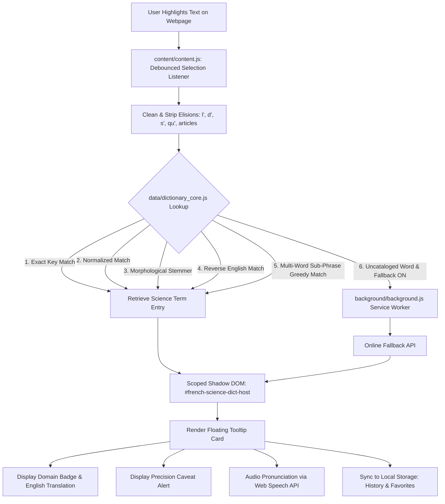

# French Science Dictionary: Domain Expert Audit & Review Guide

This document is prepared specifically for **mathematicians, AI researchers, computer scientists, physicists, computational linguists, and browser extension security auditors** reviewing the French Science Dictionary codebase and lexicon.

---

## 1. Executive Summary & Architecture

The **French Science Dictionary** is a Manifest V3 browser extension for Brave, Google Chrome, and Chromium-based browsers. Its primary objective is to eliminate linguistic degradation and catastrophic false friends when translating academic and research French literature into English.

### Architectural Overview



---

## 2. Scientific & Terminological Standards

French academic and scientific prose follows strict stylistic and taxonomic traditions established by:
- **Nicolas Bourbaki** (*Éléments de mathématique*)
- **Société Mathématique de France (SMF)**
- **Centre National de la Recherche Scientifique (CNRS)**
- **Institut National de Recherche en Informatique et en Automatique (INRIA)**
- **American Mathematical Society (AMS)** and **IEEE Computer Society** standards for corresponding English nomenclature.

Generic translation models (Google Translate, DeepL, generic LLMs) optimize for everyday colloquial French, frequently generating catastrophic mistranslations in scientific contexts.

---

## 3. Discipline-by-Discipline Scientific Audit

### 3.1 Abstract Algebra & Number Theory

| French Term | Literal / Generic Mistranslation | Precise STEM Translation | Axiomatic Context & Audit Rationale |
| :--- | :--- | :--- | :--- |
| **corps** | *body* | **field** | In abstract algebra, a set with two operations $(K, +, \cdot)$ where every non-zero element has an inverse. A *corps commutatif* is a field. A non-commutative *corps* (*corps gauche*) is a division ring or skew field. Translating as "body" renders algebraic proofs meaningless. |
| **corps fini** | *finished body* | **finite field / Galois field** | Field of prime-power order $q = p^k$, denoted $\mathbb{F}_q$ or $\mathrm{GF}(q)$. |
| **anneau** | *ringlet / loop* | **ring** | Algebraic structure $(A, +, \cdot)$ generalizing the integers $\mathbb{Z}$. |
| **idéal** | *idealistic* | **ideal** | Subring $I \subseteq A$ absorbing multiplication from $A$. |
| **morphisme** | *morphism* | **homomorphism / morphism** | Structure-preserving map between algebraic objects. |
| **espace quotient** | *quotient space* | **quotient space / factor space** | Set of equivalence classes modulo an equivalence relation or subspace. |

### 3.2 Linear Algebra & Spectral Theory

| French Term | Literal / Generic Mistranslation | Precise STEM Translation | Axiomatic Context & Audit Rationale |
| :--- | :--- | :--- | :--- |
| **valeur propre** | *clean value / proper value* | **eigenvalue** | From German *eigen* (own/characteristic). The scalar $\lambda$ such that $T(v) = \lambda v$ for $v \neq 0$. |
| **vecteur propre** | *clean vector* | **eigenvector** | Non-zero vector whose direction is invariant under linear operator $T$. |
| **sous-espace propre** | *clean subspace* | **eigenspace** | Subspace $\ker(T - \lambda I)$. |
| **noyau** | *nucleus / core / pit* | **kernel / null space** | $\ker(f) = \{x \in E : f(x) = 0\}$. In physics/biology *noyau* is nucleus/core; in linear algebra, it is strictly kernel or null space. |
| **image** | *picture / image* | **image / range / column space** | $\mathrm{Im}(f) = \{f(x) : x \in E\}$. For matrices, the column space. |
| **théorème du rang** | *rank theorem* | **rank-nullity theorem** | $\dim(\ker f) + \dim(\mathrm{Im} f) = \dim(E)$. Known universally as rank-nullity in English. |
| **matrice semblable** | *similar matrix* | **similar matrix** | Matrices related by change of basis: $B = P^{-1} A P$. |
| **matrice de passage** | *passage matrix* | **change-of-basis matrix / transition matrix** | Matrix expressing new basis coordinates in terms of the old basis: $P_{B \to B'}$. |
| **forme linéaire** | *linear form* | **linear functional / linear form** | Linear map from vector space $E$ to its base field $K$: $E \to K$. |
| **produit scalaire** | *scalar product* | **inner product / dot product** | Positive-definite symmetric bilinear form on a real vector space. |
| **espace préhilbertien** | *pre-Hilbert space* | **inner product space** | Real or complex vector space endowed with an inner product (not necessarily complete). |

### 3.3 Topology & Functional Analysis

| French Term | Literal / Generic Mistranslation | Precise STEM Translation | Axiomatic Context & Audit Rationale |
| :--- | :--- | :--- | :--- |
| **adhérence** | *adherence / sticking* | **closure** | The smallest closed set containing $A$, denoted $\bar{A}$ or $\mathrm{Cl}(A)$. Translating as "adherence" is an acute false friend. |
| **variété** | *variety* | **manifold** (diff geom) / **variety** (alg geom) | In differential geometry, *variété différentielle* is a smooth manifold. Translating differential manifolds as "varieties" creates severe confusion with algebraic varieties over algebraically closed fields. |
| **recouvrement** | *recovery / overlap* | **covering / cover** | A collection of open sets whose union contains $X$ ($\bigcup U_i \supseteq X$). "Open cover", never "recovery". |
| **voisinage** | *neighborhood* | **neighborhood** | An open set containing point $x$, or a set containing an open set around $x$. |
| **connexe** | *connected* | **connected** | Space that cannot be partitioned into two disjoint non-empty open sets. |
| **connexe par arcs** | *arc-connected* | **path-connected** | Any two points can be connected by a continuous map $\gamma: [0, 1] \to X$. |
| **dénombrable** | *countable* | **countable** | In bijection with a subset of natural numbers $\mathbb{N}$. |

### 3.4 Real & Complex Analysis / Calculus

| French Term | Literal / Generic Mistranslation | Precise STEM Translation | Axiomatic Context & Audit Rationale |
| :--- | :--- | :--- | :--- |
| **développement limité** | *limited development* | **Taylor expansion / asymptotic expansion** | Local polynomial approximation $f(x) = P_n(x) + o((x - x_0)^n)$ (abbreviated DL). |
| **primitive** | *primitive* | **antiderivative** | Function $F$ such that $F' = f$. English calculus standardly uses "antiderivative". |
| **théorème des accroissements finis** | *theorem of finite increments* | **mean value theorem (MVT)** | $f(b) - f(a) = f'(c)(b - a)$ (abbreviated TAF). |
| **théorème des gendarmes** | *police theorem* | **squeeze theorem / sandwich theorem** | If $g \le f \le h$ and $\lim g = \lim h = L$, then $\lim f = L$. |
| **théorème des valeurs intermédiaires** | *intermediate values theorem* | **intermediate value theorem (IVT)** | Continuous function on $[a, b]$ attains all values between $f(a)$ and $f(b)$ (TVI). |
| **borne supérieure / inférieure** | *superior / inferior boundary* | **supremum (sup) / infimum (inf)** | Least upper bound / greatest lower bound. Distinguished from max/min. |
| **s'annuler** | *to cancel* | **to vanish / to equal zero** | Formal mathematical English for $f(x) = 0$ is "to vanish" (e.g. *the derivative vanishes at the boundary*). |

### 3.5 Probability & Statistics

| French Term | Literal / Generic Mistranslation | Precise STEM Translation | Axiomatic Context & Audit Rationale |
| :--- | :--- | :--- | :--- |
| **tribu** | *tribe* | **$\sigma$-algebra / $\sigma$-field** | Collection of subsets closed under complementation and countable unions. In French probability literature, *tribu* is universal. Translating as "tribe" is a catastrophic error. |
| **espérance** | *hope* | **expected value / expectation** | $\mathbb{E}[X] = \int_\Omega X d\mathbb{P}$. Translating as "hope" ruins statistical papers. |
| **loi forte des grands nombres** | *strong law of big numbers* | **strong law of large numbers (SLLN)** | Sample average converges almost surely: $\bar{X}_n \xrightarrow{a.s.} \mathbb{E}[X]$. |
| **théorème central limite** | *central limit theorem* | **central limit theorem (CLT)** | Abbreviated TCL in French, CLT in English. |
| **estimateur sans biais** | *estimator without bias* | **unbiased estimator** | $\mathbb{E}[\hat{\theta}] = \theta$. Standard statistical nomenclature. |
| **presque sûrement** | *almost surely* | **almost surely (a.s.)** | Event occurs with probability 1. Abbreviated p.s. in French, a.s. in English. |
| **presque partout** | *almost everywhere* | **almost everywhere (a.e.)** | Holds outside a set of measure zero. Abbreviated p.p. in French, a.e. in English. |

### 3.6 Artificial Intelligence & Machine Learning

| French Term | Literal / Generic Mistranslation | Precise STEM Translation | Axiomatic Context & Audit Rationale |
| :--- | :--- | :--- | :--- |
| **descente de gradient stochastique** | *stochastic gradient descent* | **stochastic gradient descent (SGD)** | Iterative optimization using mini-batch estimates of loss gradient. |
| **rétropropagation du gradient** | *retro-propagation of gradient* | **backpropagation / backward pass** | Reverse-mode automatic differentiation applying the chain rule through neural layers. |
| **fonction de perte / de coût** | *function of loss* | **loss function / cost function** | Objective function measuring deviation between prediction $\hat{y}$ and target $y$. |
| **surapprentissage** | *over-learning* | **overfitting** | Model fitting noise rather than underlying data distribution. |
| **sous-apprentissage** | *under-learning* | **underfitting** | Inability of hypothesis class to capture data distribution. |
| **plongement** | *plunging* | **embedding (vector/word embedding)** | Mapping discrete tokens or high-dimensional entities into low-dimensional continuous vector space. |
| **auto-attention** | *self-attention* | **self-attention mechanism** | Scaled dot-product attention computed within a single sequence. |
| **abandon** | *abandonment* | **dropout** | Random deactivation of neurons with probability $p$ during training for regularization. |
| **invite** | *invitation* | **prompt** | Natural language conditioning input supplied to foundation models. |
| **ajustement fin** | *fine adjusting* | **fine-tuning** | Adaptation of pre-trained model weights on target domain datasets. |

### 3.7 Computer Science & Discrete Systems

| French Term | Literal / Generic Mistranslation | Precise STEM Translation | Axiomatic Context & Audit Rationale |
| :--- | :--- | :--- | :--- |
| **tas** | *pile* | **heap (binary heap)** | Tree-based data structure satisfying the heap property. |
| **pile** | *battery / pile* | **stack (LIFO)** | Last-In First-Out data structure. *tas* is heap, *pile* is stack. |
| **file** | *line / wire* | **queue (FIFO)** | First-In First-Out data structure. |
| **arbre couvrant minimal** | *minimal covering tree* | **minimum spanning tree (MST)** | Subgraph connecting all vertices without cycles with minimum total weight. |
| **interblocage** | *inter-blocking* | **deadlock** | Circular wait condition among concurrent execution threads. |
| **exclusion mutuelle** | *mutual exclusion* | **mutual exclusion (mutex)** | Concurrency primitive ensuring critical sections are accessed by at most one thread. |
| **ramasse-miettes** | *crumb gatherer* | **garbage collector (GC)** | Automated runtime memory deallocation system. |
| **problème de l'arrêt** | *problem of stopping* | **halting problem** | Canonical undecidable decision problem proven by Alan Turing. |

### 3.8 Academic French Proof Mechanics & Connectors

| French Formulation | Literal Translation | Conventional English Proof Discourse |
| :--- | :--- | :--- |
| **Soit $E$ un espace...** | *Be E a space...* | **Let $E$ be a space...** |
| **Posons $x_0 = 1$** | *Let's put $x_0 = 1$* | **Let us set / define $x_0 = 1$** |
| **Or, $f$ est continue...** | *Gold / Now, $f$ is continuous...* | **Now, $f$ is continuous... / Notice that $f$ is continuous...** |
| **D'où le résultat** | *From where the result* | **Whence the result / Hence the stated result** |
| **Il s'ensuit que...** | *It follows itself that...* | **It follows that...** |
| **Raisonnons par l'absurde** | *Let's reason by the absurd* | **Assume for the sake of contradiction...** |
| **Par récurrence sur $n$** | *By recurrence on $n$* | **By mathematical induction on $n$** |
| **Réciproquement...** | *Reciprocally...* | **Conversely...** |
| **Il vient :** | *It comes :* | **We obtain: / It follows that:** |
| **Sans perte de généralité (SPDG)** | *Without loss of generality* | **Without loss of generality (WLOG)** |
| **CQFD (Ce qu'il fallait démontrer)** | *What was needed to demonstrate* | **Q.E.D. (quod erat demonstrandum)** |

---

## 4. Morphological Engine & Lemmatization Specification

The engine implements a multi-pass normalization and lemmatization pipeline:

1. **Punctuation & Quote Stripping**: Strips external Unicode quotation marks (`«`, `»`, `“`, `”`, `"`, `'`), parentheses, brackets, and math symbols.
2. **Elision Decoupling**: French clitics and elided prepositions (`l'`, `d'`, `s'`, `c'`, `qu'`, `j'`, `t'`, `m'`, `n'`) are stripped to expose the bare nominal or verbal root.
3. **Leading Article Normalization**: Leading definite and indefinite articles (`le `, `la `, `les `, `un `, `une `, `des `, `du `, `au `, `aux `) are decoupled.
4. **Diacritic Invariant Indexing**: Accented graphemes (`é`, `è`, `ê`, `ë`, `à`, `â`, `î`, `ï`, `ô`, `ù`, `û`, `ç`) are converted to standard ASCII equivalents via NFD normalization (`normalize('NFD').replace(/[\u0300-\u036f]/g, '')`).
5. **Morphological Number & Gender Stemming**:
   - Irregular plurals: `-eaux` ➔ `-eau` (*réseaux* ➔ *réseau*, *tableaux* ➔ *tableau*).
   - Plural adjectives: `-aux` ➔ `-al` (*normaux* ➔ *normal*, *diagonaux* ➔ *diagonal*).
   - Standard plurals: Trailing `-s` and `-x` are trimmed, exempting invariant stems (*corps*, *cas*, *fois*, *vers*, *sans*, *dans*, *près*).
   - Feminine agreements: `-ée(s)` ➔ `-é`, `-ive(s)` ➔ `-if`, `-e` ➔ masculine root (*bornée* ➔ *borné*, *compacte* ➔ *compact*).
   - Multi-word concord: Handles joint plural agreements (*valeurs propres* ➔ *valeur propre*, *espaces vectoriels* ➔ *espace vectoriel*).
6. **Verbal Inflection Resolution**:
   - Third-person plural present: `-ent` ➔ `-er` (*convergent* ➔ *converger*).
   - Pronominal reflexive verbs: Conjugated forms like *s'annulent* / *s'annule* resolve to the infinitive *s'annuler*.
   - Participles and first-person plural: `-ant` ➔ `-er`, `-ons` ➔ `-er` (*posons* ➔ *poser*).
7. **Greedy Multi-Word Matching**: Entries are sorted in descending order of character length. Multi-word phrases take precedence over individual component tokens (e.g. *descente de gradient stochastique* is matched as a single atomic unit rather than separately matching *gradient* or *descente*).

---

## 5. Security & Privacy Audit

### 5.1 Manifest V3 Compliance
- Built strictly to the **Google Chrome & Chromium Manifest V3** specification.
- Does **not** use `eval()`, `new Function()`, or any dynamically injected remote scripts.
- Background process runs as an event-driven Service Worker (`background/background.js`).

### 5.2 Scoped Shadow DOM Isolation
The extension UI is injected using an isolated Shadow DOM (`mode: 'open'` on `#french-science-dict-host`):
- **Zero Style Pollution**: Host page CSS rules (CSS resets, frameworks like Tailwind or Bootstrap, high-specificity selectors) cannot leak into or break the tooltip layout.
- **Zero Host Tampering**: Extension styles cannot affect host webpage layout.
- **Z-Index Boundary**: Configured with `z-index: 2147483647` to ensure readability over fixed scientific viewers (e.g. MathJax containers, PDF readers, arXiv HTML viewers).

### 5.3 Privacy & Data Transmission Policy
- **Offline-First by Design**: The core scientific database resides entirely inside the extension package. Zero network requests occur during normal operation.
- **Zero Telemetry**: No analytics, telemetry trackers, or external logging.
- **Local Storage Isolation**: Search history and bookmarks are saved exclusively to the browser's sandboxed `chrome.storage.local`.
- **Online Fallback Transparency**: Online fallback queries are strictly opt-in (toggleable via the Settings tab), triggering only when an uncataloged term is highlighted and the user has enabled the fallback.

---

## 6. How to Run Automated Verification Tests

Domain experts can verify all lexical mappings, false friend guarantees, and morphological stemming rules by running the built-in test suite:

```bash
# From the project root
npm test
```

Expected output:
```
======================================================
🧪 FRENCH SCIENCE DICTIONARY - DOMAIN AUDIT TEST SUITE
======================================================
📊 1. DATABASE INTEGRITY & METRICS (PASS)
⚠️  2. SCIENTIFIC FALSE FRIENDS AUDIT (PASS)
🧠 3. MORPHOLOGICAL STEMMING & LEMMATIZATION AUDIT (PASS)
📐 4. MULTI-WORD EXPRESSION GREEDY MATCHING AUDIT (PASS)
🔄 5. REVERSE ENGLISH-TO-FRENCH LOOKUPS AUDIT (PASS)
🔍 6. SEARCH & AUTOCOMPLETE ENGINE AUDIT (PASS)
======================================================
TOTAL TESTS RUN : 95
PASSED          : 95
FAILED          : 0
🎉 ALL AUDIT AND REGRESSION TESTS PASSED WITH 100% SUCCESS!
```
